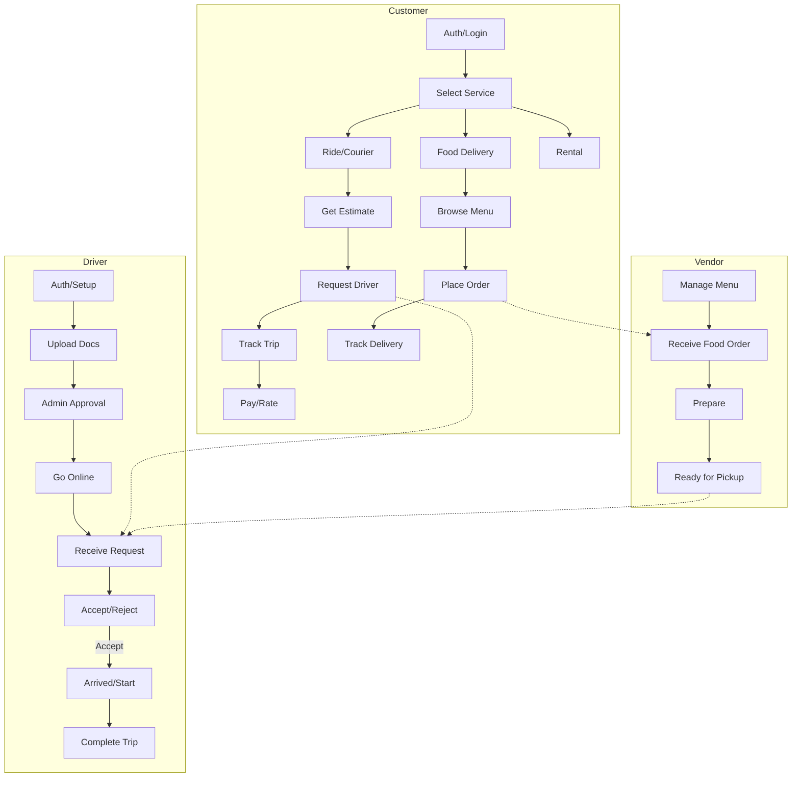

# T-Ride Mobile API Documentation

## Overview
This document provides a comprehensive guide to the Mobile API endpoints for the T-Ride application. The API supports Riders, Drivers, and Food Vendors.

---

## Authentication & Profile
**Base Path:** `/api/app`

| Endpoint | Method | Auth Required | Description |
| :--- | :--- | :--- | :--- |
| `/login` | `POST` | No | Login using credentials (Identifier & Password). |
| `/send-otp` | `POST` | No | Send OTP via SMS, Email, or WhatsApp. |
| `/verify-otp` | `POST` | No | Verify OTP to authenticate. |
| `/register` | `POST` | No | Register a new user (Customer or Driver). |
| `/get-profile` | `GET` | Yes | Retrieve current authenticating user profile. |
| `/save-location` | `POST` | Yes | Update user's current latitude and longitude. |
| `/submit-feedback` | `POST` | Yes | Submit app feedback or ratings. |
| `/logout` | `POST` | Yes | Invalidate the current session token. |

---

## Ride Services (Customer/Rider)
**Base Path:** `/api/app/rides`

| Endpoint | Method | Description |
| :--- | :--- | :--- |
| `/nearby-drivers` | `POST` | Find active drivers within a 5km radius based on vehicle type. |
| `/estimate` | `POST` | Calculate estimated fare and distance between pickup and drop-off. |
| `/request` | `POST` | Create a new ride request (Searching or Direct Assignment). |
| `/active` | `GET` | Get details of the current active ride. |
| `/{id}/cancel` | `POST` | Cancel a ride request before/during the trip. |
| `/{id}/rate` | `POST` | Submit a 1-5 star rating and comment for a completed ride. |

---

## Food Delivery (Customer)
**Base Path:** `/api/app/food`

| Endpoint | Method | Description |
| :--- | :--- | :--- |
| `/home` | `GET` | Get categories and nearby/featured vendors. |
| `/vendor/{id}` | `GET` | Get vendor menu, products, and details. |
| `/order/place` | `POST` | Place a food order with multiple items. |
| `/order/{id}/track` | `GET` | Real-time tracking of order status and driver position. |
| `/user/addresses`| `GET` | Get saved user delivery addresses. |

---

## Driver Controls
**Base Path:** `/api/app/driver`

| Endpoint | Method | Description |
| :--- | :--- | :--- |
| `/profile-setup` | `POST` | Initial setup for driver information (Vehicle, Region). |
| `/upload-docs` | `POST` | Upload CNIC, License, and Vehicle documents for approval. |
| `/status` | `GET` | Check account approval status and online/offline state. |
| `/toggle-online` | `POST` | Switch between Online (Accepting Jobs) and Offline. |
| `/dashboard` | `GET` | View earnings (Today, Weekly, Monthly) and trip stats. |
| `/ride-requests`| `GET` | Fetch new incoming ride requests matching vehicle type. |
| `/ride/{id}/respond` | `POST` | Accept or Reject a specific ride request. |
| `/ride/{id}/status` | `POST` | Update ride status: `arrived`, `in_progress`, `completed`. |

---

## Wallet & Payments
**Base Path:** `/api/app/wallet`

| Endpoint | Method | Description |
| :--- | :--- | :--- |
| `/data` | `GET` | View current balance and transaction history. |
| `/add-money` | `POST` | Deposit funds into the wallet via payment gateway. |
| `/withdraw` | `POST` | Request withdrawal of funds to bank/mobile account. |

---

## Rental Services
**Base Path:** `/api/app/rental`

| Endpoint | Method | Description |
| :--- | :--- | :--- |
| `/items` | `GET` | List available items for rent (Equipments, Cars, etc.). |
| `/item/{id}` | `GET` | Detailed view of a specific rental item. |
| `/book` | `POST` | Book an item for a specific duration. |
| `/my-bookings` | `GET` | View history of rental bookings. |

---

## Use Case Diagram (Logic Flow)

---
*Note: All authenticated requests require a Bearer Token in the Authorization header.*
